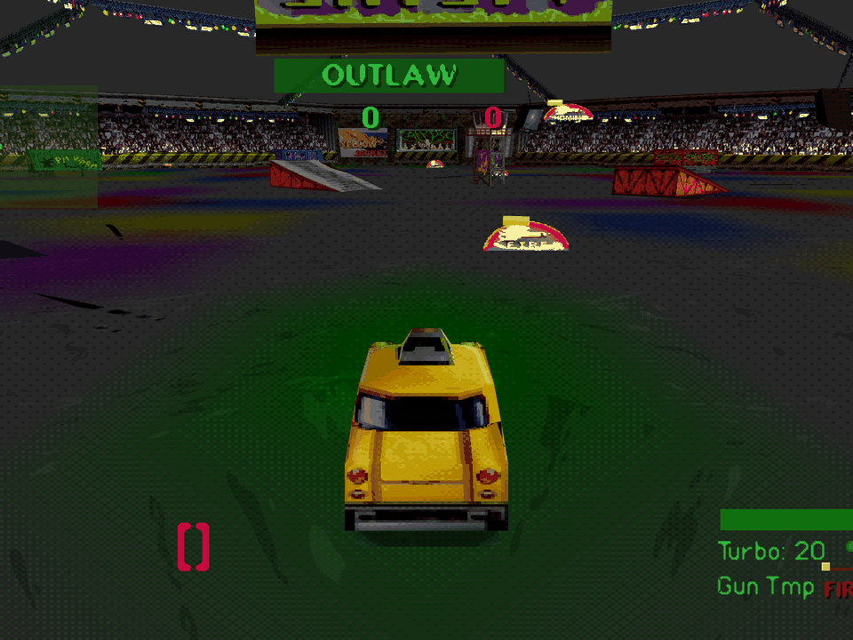
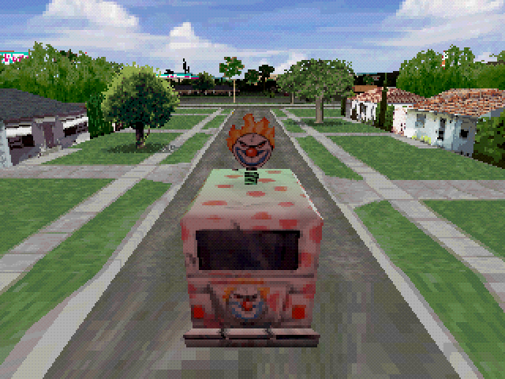
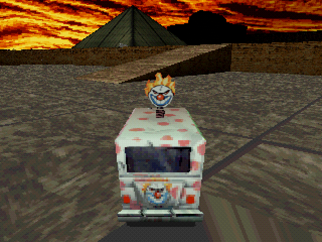
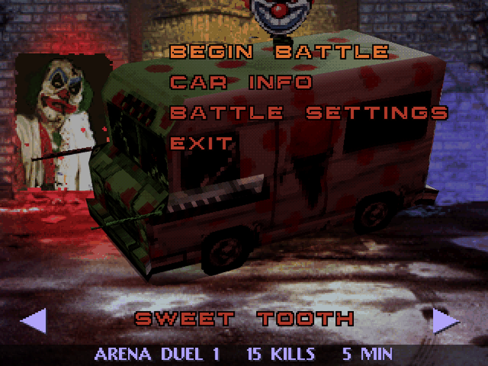
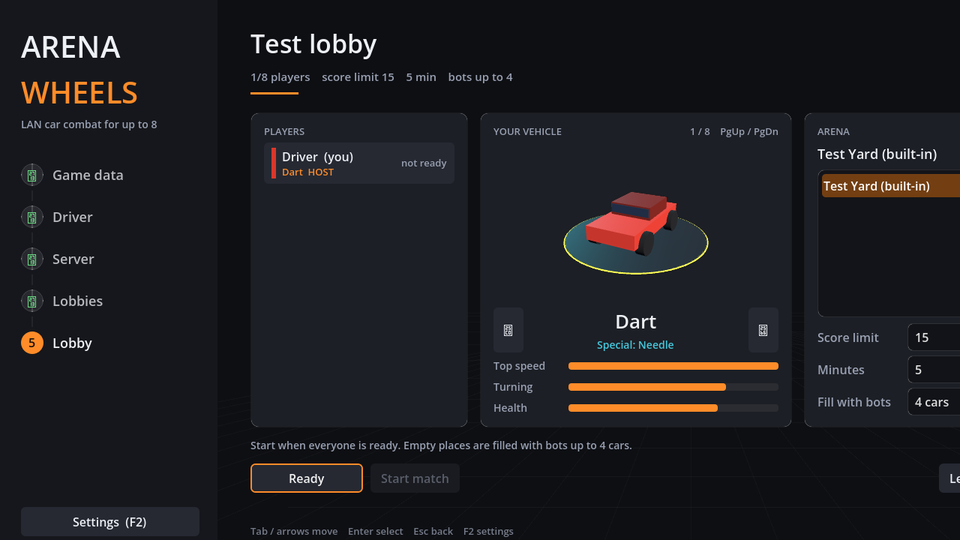
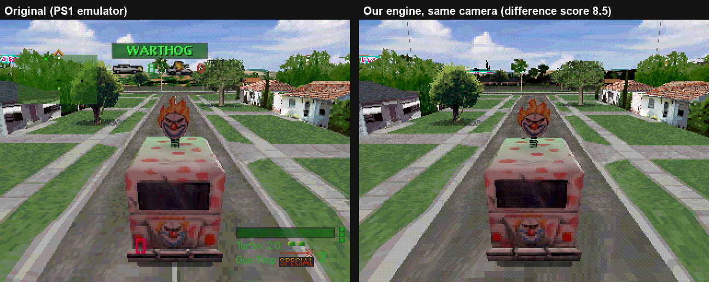

# ps1-game-club

A kit for game clubs that want to play their own PlayStation (PS1) games together. It has three parts, and
they do very different amounts of work for you:

| Part | What it gives you | What it does not do |
|---|---|---|
| [`play/`](play/README.md) | Play any PS1 game you own with friends, through an emulator, in the browser or natively, online for games that already have 2+ player modes. | It does not add players to a game: a one-player game stays one-player. |
| Remake kit: [`tools/`](tools/README.md), [`engine/`](engine/README.md), [`deploy/`](deploy/docker/README.md), [`docs/remake-guide.md`](docs/remake-guide.md) | The game-independent pieces and the method for rebuilding one game natively, with 8-player online play, in Chrome and on desktop. | There is no button that turns any PS1 game into a native multiplayer game. A remake is per-game work: weeks of reverse-engineering, measuring and porting, for one game at a time. |
| [`games/twisted-metal/`](games/twisted-metal/README.md) | A finished worked example: Twisted Metal (USA, PS1) rebuilt for 8 players on a LAN, with measured fidelity results. | It does not include the game. You need your own disc. |

**No game content is included.** Not one file from any disc is in this repository: no images, models, sounds,
music, executables or BIOS files. Every player reads their own disc with the tools here, and the programs read
that folder at run time. `scripts/leak_check.sh` checks every commit for that.



## 1. Play any PS1 game with friends (`play/`)

The emulator-based part: run a PS1 game you own in the browser (EmulatorJS) or natively (RetroArch), both
with the PCSX-ReARMed core, and play it with friends online. Netplay there is input sharing: every player runs
the same game and the button presses are exchanged, so it works for games that already have a two-or-more
player mode and cannot add multiplayer to a game that has none. Setup, supported platforms and limits are in
[`play/README.md`](play/README.md).

## 2. The remake kit

For a game you want to rebuild natively, with real online multiplayer (each player in their own car, their
own camera, prediction and lag compensation), not a shared emulated screen.

- **[`tools/`](tools/README.md)**: Python readers for PS1 discs and formats (CUE/BIN and ISO 9660, TIM images,
  VRAM, VAB sound banks, XA audio, STR movies), a headless emulator harness that runs the game with no window,
  presses buttons by script and reads RAM (`emu_harness.py`, `nav.py`, `measure.py`), a script that builds
  the PCSX-ReARMed libretro core from source (`build_core.sh`), and a software model preview.
- **[`engine/`](engine/README.md)**: a Godot 4.7.2 project with:
  - 8-player server-authoritative netcode: lobbies, client prediction, delta snapshots, lag compensation;
  - one headless server that hosts many lobbies and serves the web build over HTTPS and WSS on a single
    address, with its own self-signed certificate for LAN play;
  - web (Chrome), macOS, Windows and Linux export presets;
  - an access gate and proxy mode for hosting behind a reverse proxy;
  - a runtime loader framework that reads game data only through a manifest, the same way on desktop and in
    the browser.
  `engine/GAME_SPECIFIC.md` says which scripts are generic and which belong to the Twisted Metal example.
- **[`deploy/docker/`](deploy/docker/README.md)**: a generic container recipe (Debian slim base, set by a
  build argument) for running the server behind any https proxy. The access key is an environment variable,
  never part of the image or the repository.
- **[`docs/remake-guide.md`](docs/remake-guide.md)**: the method, step by step, written from the Twisted Metal
  run with its real numbers: extract the disc, decode the formats, run the game headless, find the RAM
  structures, measure physics and weapons per game tick, port into the engine, compare side by side, the
  netcode design, and hosting.

| | |
|---|---|
|  |  |
|  |  |

## 3. The worked example: Twisted Metal (USA)

[`games/twisted-metal/`](games/twisted-metal/README.md) has the Twisted Metal decoders and format notes,
`organize.py` (builds your `gamedata/` folder from your disc), and the measured gameplay numbers. Its README
shows how to build `gamedata/`, host a game with `engine/host.sh` and play with friends on a LAN in Chrome,
and the results: graphics within a difference score of 6-16 of the original (from 39-67 before the fidelity
pass), driving within 2.1% position error, and about 2.7 KB/s per player with 96-98% of prediction
corrections under 5 cm.



## Quick start (Twisted Metal example)

```bash
python3 -m pip install numpy pillow
games/twisted-metal/build_gamedata.sh "/path/to/Twisted Metal (USA).cue"     # builds gamedata/ from your disc
/path/to/Godot --headless --path engine --import
/path/to/Godot --headless --path engine --export-release "Web" ../dist/web/index.html
GODOT=/path/to/Godot engine/host.sh --data=gamedata                            # prints the address to open
```

## Requirements

- Python 3.10 or newer with `numpy` and `Pillow`.
- Godot 4.7.2 (standard build) and its export templates for web or desktop builds. `host.sh` and the tests use
  `$GODOT`, defaulting to the macOS app path.
- For the emulator harness: git, make and a C compiler to build the core.
- Chrome (or another Chromium browser) for the web version.

## Repository rules

- Never commit anything read from a disc: `gamedata/`, `cache/`, `emu/` and `dist/` are git-ignored, and so are
  disc images, BIOS files and every PS1 or audio format the tools read or write.
- Run `scripts/leak_check.sh` before every commit. It must report 0 hits.
- No secrets in the repository. Access keys come from the environment.

## Licence

GPL-3.0. See [LICENSE](LICENSE). Twisted Metal and PlayStation are trademarks of their owners; this project is
not affiliated with or endorsed by them, and it includes none of their content.
