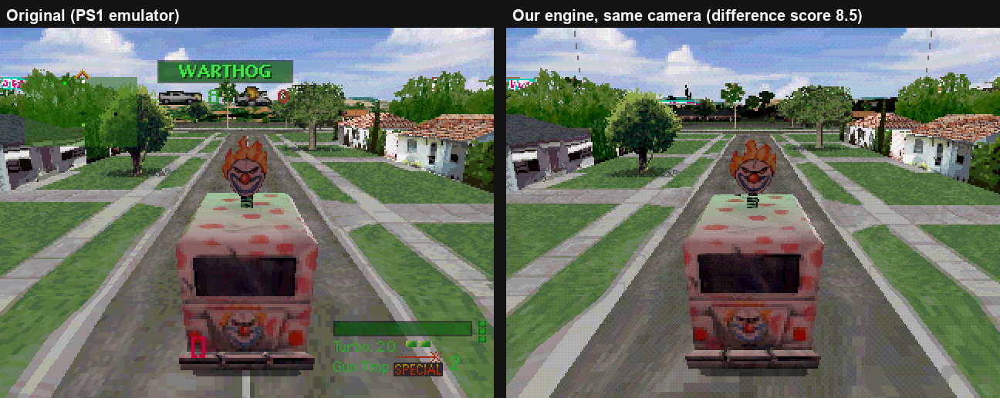

# Remaking a PS1 game for online play: the method

This is how the Twisted Metal (USA) remake in `games/twisted-metal/` was made, written so you can do the same
for another game. It is per-game work: expect weeks, not an afternoon. The tools in `tools/` and the engine in
`engine/` cover the parts that do not depend on the game; this guide covers the order of work and what to
watch out for. Every number below is a real one from the Twisted Metal run.

The rule throughout: nothing from the disc goes into the repository or into a build. Each player builds a
`gamedata/` folder from their own disc and the engine reads it at run time. What you publish is code, format
notes and measured numbers.

## Contents

1. [Extract the disc](#1-extract-the-disc)
2. [Find and decode the formats](#2-find-and-decode-the-formats)
3. [Run the game headless in the emulator](#3-run-the-game-headless-in-the-emulator)
4. [Find the RAM structures](#4-find-the-ram-structures)
5. [Measure physics and weapons per game tick, then fit them](#5-measure-physics-and-weapons-per-game-tick-then-fit-them)
6. [Port into the engine](#6-port-into-the-engine)
7. [Compare side by side](#7-compare-side-by-side)
8. [The netcode design](#8-the-netcode-design)
9. [Hosting](#9-hosting)

## 1. Extract the disc

A PS1 disc image is a `.cue` sheet plus one or more `.bin` files of raw 2352-byte CD sectors. Track 1 is data
(Mode 2); later tracks are often CD audio.

```bash
python3 -I tools/disc.py "/path/to/Game.cue" cache
```

`disc.py` reads the ISO 9660 file system from the data track (the primary volume descriptor is sector 16;
user data starts 24 bytes into each Mode 2 Form 1 sector) and writes every file to `cache/files/`. Movies and
other interleaved streams (`.STR`, `.XA`) use Form 2 sectors, so it copies those as whole 2352-byte sectors.
CD-audio tracks become WAV files in `cache/music/` after skipping the 2-second pregap.

Twisted Metal: 164 files and 8 music tracks. Two things were surprising and are typical:

- The `.44D` files have a wrong size in their directory entries and are empty. They are pointers to the CD
  audio tracks (the first starts at sector 39578, the end of the data track plus 150).
- The executable, `SCUS_943.04`, is worth keeping: it later gave us the menu font glyph tables, the UI
  strings and the car names, read at fixed offsets and checked against a known value before use.

## 2. Find and decode the formats

Start with the formats every PS1 game shares, then the game's own.

**Shared formats** (tools ready in `tools/`):

| Format | What it is | Tool |
|---|---|---|
| TIM | Image with its own VRAM position and palette, 4/8/16/24-bit | `tim.py` |
| VRAM | The 1024x512 16-bit video memory textures are sampled from | `vram.py` |
| VAB | Sound bank: header, programs, tones, SPU ADPCM samples (magic `pBAV`) | `vab.py` |
| XA | CD-XA ADPCM audio | `xa.py` |
| STR | Movies: MDEC video sectors plus XA audio sectors | `str.py` |

**The game's own formats.** Look at file names and sizes first, then hex dumps. Look for a magic string at
offset 0, a count, then offsets. Twisted Metal's models (`UADMD/*.DMD`) start with `DXSPC`, and their textures
(`*.TMS`) with `TXSPC` followed by a count and a list of TIMs. The DMD files turned out to be memory images
loaded at `0x800188B8`, with absolute pointers, so every pointer minus that base is a file offset. Once that
clicked, the rest was walking the scene graph: nine node types (group, translate, rotate+translate, level of
detail, animation, switch, spatial split, mesh, box), each with a fixed layout. `games/twisted-metal/FORMATS.md`
has all of it.

How to make progress on an unknown format:

- **Count first.** Write a parser that only walks the structure and prints counts. When the record sizes add
  up exactly over every file (Twisted Metal: the polygon size formula held for all 104,018 polygon records on
  the disc), the layout is right.
- **Render early.** `tools/preview.py` is a software renderer for decoded models. Seeing an arena from above
  caught wrong transforms, wrong texture windows and missing lighting much faster than numbers did.
- **Check against the emulator.** Several answers came only from the running game: the lighting (three lights
  and an ambient of 0.125, read from the game's light set-up routine), the per-arena background colour (a
  screen clear colour the level code sets), and which half of an arena file is used for which car.
- **Write down what is not known.** `FORMATS.md` ends with open questions. That list keeps you from
  treating a guess as a fact later.

When the decoders are solid, write the step that builds `gamedata/`: `games/twisted-metal/organize.py` picks
the files the engine needs, sorts them by use, and writes `manifest.json` with a SHA-1 per file. The engine
then finds everything through the manifest, so it never needs to know the disc's own folder layout.

## 3. Run the game headless in the emulator

To measure the original you need to run it with no window, press buttons by script and read its RAM.

```bash
tools/build_core.sh          # clones and builds the PCSX-ReARMed libretro core into emu/ (git-ignored)
```

`tools/emu_harness.py` is a small libretro front end written with `ctypes`. It loads the core, hands it your
`.cue`, and gives you `run(frames, buttons)`, `ram()` (the 2 MB of PS1 RAM as a numpy array),
`save_state()`/`load_state()` and `screenshot()`. Audio is discarded and nothing is drawn on screen. The core
uses its built-in HLE BIOS, so no BIOS file is needed.

Practical lessons:

- **Save states are your checkpoints.** Getting from the title screen to a match takes several hundred frames of
  scripted menu presses. Do it once per car (`tools/measure.py`'s `start_match`), save a state, and start every measurement from that state.
  The Twisted Metal run kept 12 match states, one per car.
- **Find the game's tick.** Twisted Metal's logic runs once every 3 emulator frames, so 20 ticks per second.
  Measure per tick, not per frame: align to a tick boundary first (`measure.py`'s `align`, which steps frames
  until the position changes), then step 3 frames at a time.
- **Look at frames.** `nav.py` makes contact sheets of screenshots so you can check that a script is where you
  think it is.

## 4. Find the RAM structures

The values you want (position, heading, speed, health, ammo) live in structs in RAM. Find them by
differencing:

- **Values that only change one way.** Health was found by recording RAM every 15 frames while the opponent
  attacked an idle player, and keeping the addresses whose values only fell.
- **One button at a time.** Diff the player struct while pressing each button alone against an idle run.
  The speed field rose under Up and fell under Down; the turbo counter ran only while Triangle was held;
  the ammo array changed when L2 fired; the gun temperature rose under R2.
- **Match a signature.** The opponent struct was found by searching for the same field pattern as the
  player's (1, 1, health, max health).
- **Distrust the first answer.** The first pass used `0x80191768` as the player position. It was the camera's
  view-space translation: it changes when the player moves, but in a rotated frame. The real world position is
  at vehicle struct `0x801A179C` + 0x388/+0x38C, and every speed and turn rate from the first pass had to be
  measured again. Check a candidate by moving in a straight line and seeing whether it changes like a world
  position should.
- **Read the code when you can.** Once you know an address, breakpoints and disassembly of the routines that
  write it (the driving routines at `0x80112A1C`, `0x80113CF0` and others) give exact formulas instead of
  fitted curves.

Write the map down as you go: `games/twisted-metal/data/tuning.json` has a `ram_layout` section with every
field, its address and how it was confirmed.

## 5. Measure physics and weapons per game tick, then fit them

Each measurement is a short input script run from a saved state, reading RAM every tick.

| Behaviour | How it was measured | Result for Twisted Metal |
|---|---|---|
| Top speed, acceleration | Hold Up for 80 ticks, read the speed field each tick | Fits `dv = k (v_top - v)` per tick; from-rest value matches each car's parameter block exactly |
| Braking, coasting, handbrake | 25 ticks of throttle, then Down, then nothing, then Cross alone | Braking is close to a constant amount per tick |
| Turning | Hold Left at 25/50/75/100% of top speed, heading read every frame | Yaw rate proportional to speed, so each car turns on a near-constant circle, radius about 240-370 world units |
| Turbo | Hold Triangle, compare HUD and RAM | 2 tanks of 60 ticks, exactly 1.5x top speed |
| Weapon damage | Pin the opponent at a fixed point by writing its position every frame, zero its speed and weapons, fire once, read its health | Same damage at every distance and against every car |
| Projectile speed | Hit-time difference between two distances | Every missile flies 150 world units per tick |
| Machine gun | Hold R2 on the target for 1,500 frames | 1 damage per hit, fires every 4 ticks, 6 heat per shot, locks at 200, fires again at 100 |
| Walls | 26 runs at 0-80 degrees from head-on | Speed x0.51 up to ~47 degrees, x0.68 to ~67, x0.78 beyond |
| Jumps | 12 ramp runs, four wheel corners read every tick | Gravity on a flying corner grows with airtime, about 0.6 + 0.4 x ticks airborne |
| Rules | Kill all opponents by RAM write, level by level | Opponent counts 1, 3, 5, 6, 8, then 3 plus a boss; 3 spare lives; respawn after 91 ticks |

Two tricks did most of the work:

- **Control the other actors by writing RAM.** To measure damage cleanly, the opponent was frozen in place,
  disarmed, and the player's health was held at full. Each experiment then has one variable.
- **Fit, then check against the code.** Least-squares fits give you the shape; the parameter block and the
  disassembled routines give exact constants. The final driving model in `TUNING.md` ("Driving model") is the
  game's own formula, not a curve fit, and the fit was the check.

Keep the method and a confidence level next to every number (`data/TUNING.md` does: high, medium, guess).
Also note one trap: Twisted Metal's arenas are built at 1/32 metre per world unit, but the first conversion of
speeds used 1/64, so every car drove at half speed relative to the arena until the side-by-side comparison
in step 7 exposed it.

## 6. Port into the engine

`engine/` is a Godot 4.7.2 project with the game-independent parts already working: networking, lobbies, the
web server, export presets and a data-loading framework. Porting a game means filling in the content seams:

- **Data.** `scripts/disc/disc_files.gd` is the only reader of game data. Everything goes through
  `read_bytes(path from the manifest)`, which works the same on desktop and in the browser (where the folder
  is copied into IndexedDB once).
- **Decoders.** Port your Python decoders to GDScript and keep them line-by-line comparable.
  `scripts/disc/dmd.gd` names the Python function each part mirrors and uses 64-bit floats, and
  `tests/disc/dmd_counts_test.gd` prints the same lines as `tests/disc/dmd_counts_ref.py`: 280 object lines
  over 13 model files, identical, including the sum of every lit vertex colour. Do this; it catches porting
  slips that are invisible on screen.
- **Arenas and vehicles.** Implement an `ArenaProvider` (level mesh, sky, collision, spawn and pickup points)
  and a `VehicleModelProvider`. Until you have them, the built-in procedural arena and cars let you test the
  netcode with no game data at all.
- **Gameplay.** The vehicle is kinematic (`Vehicle.sim_step`), so the measured per-tick formulas drop in
  directly and the server and the client's prediction run the same code. Numbers come from a `tuning.json`
  that the server and every client load, so prediction matches.
- **Rendering the PS1 look.** Colours are texel x vertex colour / 128, colour 0 is transparent, four
  semi-transparency modes, texture windows for tiling, sprites as billboards, a per-arena clear colour.
  Textures are packed into atlases and can be upscaled 2x or 4x (Scale2x) once, then cached.

`engine/GAME_SPECIFIC.md` lists which scripts are generic and which are Twisted Metal's, so you can see what
to replace.

Timings to expect: loading an arena from a cached atlas took 0.2-1.0 s on an Apple M4; the first load at 4x
upscaling 1.1-2.8 s.

## 7. Compare side by side

The fidelity pass is what turned "looks about right" into measured agreement. Use the same disc, the same
start state and the same inputs in both programs, then compare numbers.

**Graphics.** For each of the six arenas, the emulator frame at the spawn point was saved together with the
camera matrix read from RAM (`0x80191750`, translation at `0x80191764`, projection distance H = 228). The
engine then rendered the same arena from that exact camera (`scripts/render/fidelity_capture.gd`, which runs in
the web build in headless Chrome and posts frames to a local test server). The score is the mean absolute RGB
difference (0-255) after a 4x4 box blur, with the HUD masked out. Before the pass the scores were 39-67; after
it, 6-16. The fixes it drove: the camera's height, distance and field of view measured from RAM, the sky dome
placement, 4:3 framing, the disc's own effect sprites, and a rendering mode with no tone mapping so the
game's colours come out unchanged.



**Physics.** The same per-tick input scripts were replayed in the emulator and through `Vehicle.sim_step`
(`scripts/tests/fidelity_runner.gd`, logging in the original's units), for all 12 cars and 19 scenario kinds.
Position error fell from 24.9% of the path to 2.1%, heading error from 9.5 to 3.4 degrees, speed error from
36% to 4.1%. The comparison found the 1/64 vs 1/32 unit error, the reverse speed (two thirds of top speed),
the slide rules and the wall response.

**Menus and HUD.** Emulator frames of each original screen were set beside ours at the same resolution, then
the layout was rebuilt from the disc's own images and fonts until they lined up.

The harness scripts on the emulator side read game frames and RAM, so they are not published here; the engine
side and the method are.

## 8. The netcode design

The engine uses a server-authoritative design with client prediction. It is built for car combat at up to 8
players per match, but nothing in it is specific to Twisted Metal.

- **One dedicated server process, many lobbies.** Each lobby's match runs in its own Godot `SubViewport` with
  its own `World3D`, so physics and state never mix between lobbies. Browsers cannot host; one machine runs
  the server headless.
- **Transport.** WebSocket for everyone (browsers and desktop), with TLS; ENet as an option for desktop.
  Packets are raw bytes, no Godot RPCs.
- **Fixed tick.** The server simulates at 30 ticks per second and sends snapshots at 20 per second.
- **Inputs.** 22-byte input packets at 30 per second carry the last 4 inputs, so one lost packet costs
  nothing. The server keeps a short queue per player: one input per tick, two when the queue grows, hold the
  car for a tick if an input is late, repeat the last input if one is lost.
- **Snapshots.** A 22-byte header, the receiving player's own car at full precision (position in mm, yaw,
  velocity, ammo, energy, heat, turbo, freeze, plus the driving state needed to replay exactly), then only the
  cars and projectiles that changed since the client's last acknowledged snapshot. A full snapshot every 2 s.
  Events (kills, explosions, destroyed props) are sent reliably with a sequence number.
- **Prediction and reconciliation.** The client runs `sim_step` for its own car every tick. When a snapshot
  says where the server had the car after a given input, the client compares, and if it differs it resets to
  the server state, replays the newer inputs and hides the jump with a decaying visual offset.
- **Remote objects.** Other cars and projectiles are drawn in the past with an adaptive delay (snapshot spacing
  plus measured jitter, 66-330 ms), extrapolating up to 0.25 s when packets stall.
- **Fairness.** Your own missiles appear the moment you fire. Machine-gun hits are checked on the server
  against where you saw the target (rewound by your render time, at most 200 ms).

Results, 8 clients, 3-minute matches: 2.7-2.9 KB/s down and 0.86 KB/s up per player; server tick 0.9-1.1 ms
average; 96.5-98% of corrections under 5 cm, with or without 50 ms latency, 20 ms jitter and 2% loss.

The bug worth knowing about: with zero latency, corrections were much worse (44% under 5 cm) than with
latency. Godot's `move_and_slide()` moves a body by the engine's current delta, which is the render-frame
delta when called outside a physics frame. Replays triggered from a network callback in `_process` moved each
replayed tick by about 7 ms of travel instead of 33 ms. The fix scales the velocity so one `sim_step` always
covers exactly one tick. After it: 97.6% under 5 cm. The tool that found it is a per-tick trace on both sides
(`--trace-pred`) diffed by `engine/tests/net/pred_diff.py`.

Test it headless, with simulated latency, on any free port:

```bash
engine/tests/net/run_lobby.sh /tmp/t1 8920 "A:8" 180 --net-latency=50 --net-jitter=20 --net-loss=2
python3 -I engine/tests/net/summary.py /tmp/t1
```

## 9. Hosting

**On a LAN** (`engine/host.sh --data=gamedata`): the server serves the web build and the game on one
address. Chrome only runs Godot web builds in a secure context, and `http://<LAN address>` is not one, so the
server makes its own TLS certificate on first run (with the machine's LAN addresses in the subjectAltName,
which Godot's built-in generator cannot add, so `server_tls.gd` writes the X.509 certificate itself) and serves
the page over HTTPS. Plain http on 8080 redirects there. The browser's game connection uses the page's own
address, `wss://<host>:8443/ws`, which the server forwards to its game port: in real Chrome, clicking
**Proceed** on the certificate warning did not cover a WebSocket on a different port. One click now covers
both. Game-data paths are refused (403) to everyone except a browser on the server machine itself.

**On the internet**, behind a reverse proxy: `deploy/docker/` builds one container with the server, the web
build and a deployment copy of your game data (music as OGG, about 50 MB). The server runs in proxy mode,
plain http behind the proxy's https, with an access gate: nothing but `/healthz` and `/login` answers without
a cookie that you get by opening `/login?key=<your key>` once. The key comes from the `TM_ACCESS_KEY`
environment variable and is never stored in the image or the repository. Because the image holds data from
your disc, keep it private to your club.

Resources are small: about 127 MB of memory and 5% of one core for a server running a 4-player match, and
2.5-2.8 KB/s per player.
