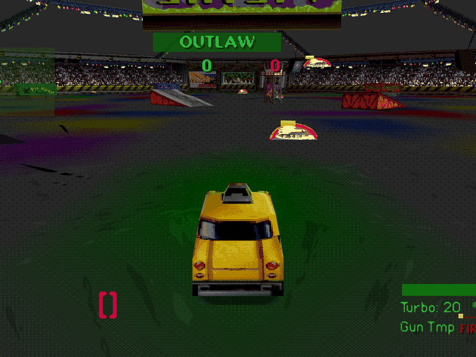
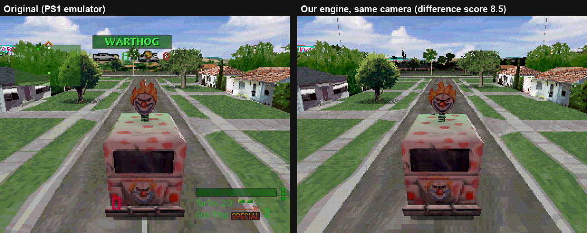

# Worked example: Twisted Metal (USA, PS1)

This folder is the game-specific half of the first remake made with this kit: Twisted Metal (USA, PS1, 1995)
rebuilt in Godot as an 8-player LAN game that runs in Chrome and on desktop. The engine reads every model,
texture, font, sound and music track from **your own disc** at run time. Nothing from the disc is in this
repository; what is here is code and measured numbers.



## What is in this folder

| Path | What it is |
|---|---|
| `dmd.py` | Decoder for the game's DMD model files: scene graphs, meshes, normals, sprites, GTE lighting, texture windows, switch/animation/split nodes. The engine's `engine/scripts/disc/dmd.gd` is a line-by-line port of it. |
| `FORMATS.md` | The formats as worked out: DMD, TMS texture sets, polygon records, lighting, sprites, pickups, start positions, switch tags and hit points, audio, movies, RAM addresses. |
| `organize.py` | Builds your `gamedata/` folder from the extracted disc: picks the files the engine uses, sorts them by use, and writes `manifest.json` with a SHA-1 for every file. The engine finds everything through the manifest. |
| `build_gamedata.sh` | Runs the whole chain (extract, decode sounds, label sounds, organize) in one go. |
| `data/tuning.json`, `data/TUNING.md` | Every gameplay number measured in the headless emulator (driving, turning, turbo, weapons, damage, ramming, jumps, rules, RAM layout) and how each was measured. These are measured facts about the game's behaviour, not game files. |
| `data/arenas/*.json` | Start positions and pickup positions for the six arenas, decoded from the game's code and models. |

The Godot scripts that are specific to this game (DMD loading, the original-layout menus and HUD, the measured
driving model) stay inside `engine/`, because splitting them out would have been a risky refactor.
`engine/GAME_SPECIFIC.md` lists them.

## 1. Build `gamedata/` from your own disc

You need your own copy of the game as a CUE/BIN image (`Twisted Metal (USA).cue` plus its `.bin` tracks),
Python 3 with `numpy` and `Pillow`, and nothing else. From the top of the repo:

```bash
games/twisted-metal/build_gamedata.sh "/path/to/Twisted Metal (USA).cue"
```

That runs four steps, which you can also run one at a time:

```bash
python3 -I tools/disc.py "/path/to/Twisted Metal (USA).cue" cache        # 164 files + 8 CD-audio tracks as WAV
python3 -I tools/vab.py cache/files/SND/UACORE.VAB cache/sfx              # 25 sound effects
python3 -I tools/sfxlabel.py cache/sfx                                    # rough labels for them
python3 -I games/twisted-metal/organize.py cache gamedata                 # 154 files + manifest.json
```

`cache/` and `gamedata/` are git-ignored. `gamedata/` is about 265 MB, almost all of it the CD music.
`organize.py` hard-links large files from `cache/` when it can, so it does not take that space twice.
The manifest should list 154 files; `engine/tests/disc/disc_load_test.gd -- --verify` re-checks every checksum.

## 2. Host it

On the machine that will host (macOS, Linux or Windows with Godot 4.7.2):

1. Build the web version once: `Godot --headless --path engine --export-release "Web" ../dist/web/index.html`
   (needs the Godot 4.7.2 export templates). It lands in `dist/web/`, git-ignored, and holds no disc files.
2. Start the server: `engine/host.sh --data=gamedata`. It runs headless, prints the address to open and keeps
   running until Ctrl+C. Ports: 8910 (game), 8443 (https page and `/ws`), 8080 (redirect to https). Pass
   other ports as `engine/host.sh 9910 9080 9443 --data=gamedata`.

The server needs the game data too: it builds each arena's collision from it. It never sends disc files to
other machines; only a browser on the server machine itself may load them from the server.

## 3. Play with friends on a LAN, in Chrome

1. Each friend opens `https://<host's LAN address>:8443/` in Chrome. The first time, Chrome warns that the
   connection is not private, because the server made its own certificate: click **Advanced**, then
   **Proceed**. That one click also covers the game connection, which runs on the same address
   (`wss://<host>:8443/ws`).
2. Each friend picks **their own** `gamedata/` folder once (built from their own disc with step 1). Chrome
   copies it into the browser's storage and keeps it. On the host machine this step is skipped.
3. Enter a name, open the lobby browser, create or join a lobby, pick a car, press Ready. The lobby host
   picks the arena, score limit, time and bots, then starts. Up to 8 players per lobby, many lobbies per server.

Controls: W/S drive, A/D steer, Ctrl handbrake, Alt turbo, Space machine gun, Shift fire weapon, Q/E change
weapon, R unstuck, Tab scores, F3 network overlay, Esc menu. Gamepads work too.

Desktop players can export the macOS, Windows or Linux preset instead and connect to `<host>:8910`.

## Results

### Fidelity

All measured against the original running in the headless emulator from the same disc.

- **Graphics.** A frame of our engine and a frame of the emulator at the same spot on each of the six
  tournament arenas are compared as the mean absolute RGB difference (0-255, after a small blur, HUD
  masked). Before the fidelity pass the scores were 39-67; after it they are 6-16 (6.4 Freeway, 7.3 Arena,
  7.8 River Park, 7.9 Rooftop, 8.9 Cyburbia, 16.2 Warehouse). With the camera pose copied from the
  emulator's RAM the scores are 5.9-16.3.
- **Driving physics.** The same per-tick input scripts (19 kinds: accelerate, brake, coast, reverse, turns,
  handbrake, turbo, slalom, wall hits at 0, 30 and 60 degrees) were replayed for all 12 cars in the emulator
  and in the engine. Mean position error fell from 24.9% of the path driven to 2.1%, heading error from 9.5
  to 3.4 degrees, speed error from 36% to 4.1% of peak.
- **Weapons and rules.** Damage, refire times, machine-gun heat, special energy, turbo, ramming, lives,
  respawn and pickup return times are the measured values in `data/tuning.json` (see `data/TUNING.md`
  for each method and its confidence).
- **Menus and HUD.** The original layout is rebuilt at run time from the disc's own screens, fonts and
  glyph tables, with optional 2x/4x upscaling.



### Netcode

Headless runs, 8 clients in one lobby, 3-minute matches over WebSocket, after the prediction fix:

| Test | Down / up per client | Corrections under 5 cm / 1 m or more |
|---|---|---|
| Warehouse, no added latency | 2.74 / 0.86 KB/s | 97.6% / 0.06% |
| Warehouse, 50 ms one way, 20 ms jitter, 2% loss | 2.84 / 0.86 KB/s | 96.5% / 0.08% |
| Test Yard, 50 ms / 20 ms / 2% | 2.90 / 0.86 KB/s | 98.0% / 0.05% |
| Two lobbies of 4, Warehouse | 1.86 / 0.86 KB/s | 97.4% / 0.04% |

A 10-minute soak with 4 clients under latency, jitter and loss showed no errors and no growing error.
A short check run for this repository (4 clients, Warehouse, 45 s) gave 2.49 / 0.86 KB/s per client and
99.2% of corrections under 5 cm. Known gap: on the Arena with 8 players and added lag about 95% of
corrections stay under 5 cm, because missile hits and rams are not predicted.

### Server resources

- Server tick (the whole simulation of one lobby, 30 per second): 0.9-1.1 ms average with 8 clients,
  0.5 ms with 4; worst single ticks 4-18 ms, when clients were building arenas on the same machine.
- Memory: about 127 MB resident for the headless server with one 4-player lobby on the Warehouse; a
  headless client uses about 240 MB.
- CPU: about 5% of one core of an Apple M4 for that lobby.
- Bandwidth out of the server: about 2.5-2.8 KB/s per player; snapshots average about 120 bytes.

## What does not work yet

- Wrecked cars have no collision; bots do not aim at props.
- A few values are guesses: ram damage to props, wheel frame rate, the soldier sprites' trigger distance,
  rear missile, rear flame and oil (these stand in as other weapons).
- Disc arenas have no health pickups; Cyburbia keeps 32 of its 34 pickups (the snapshot has 32 pickup bits).
- The STR movies are not decoded to video (only their audio).
- Damaged cars, wrecks and Rooftop's inside/outside switching were checked by structure, not looked at in a
  window.
